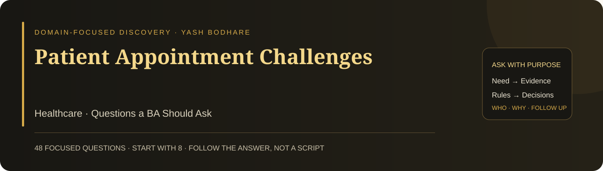

# Patient Appointment Challenges

**Domain:** Healthcare · **48 focused questions** · **Eight suggested opening priorities**

A practical questioning guide for a Business Analyst investigating this case. Each question has a suggested stakeholder and a clear discovery purpose. Ask one question, listen, and follow the answer. The full bank is a reference—not a checklist to read in one meeting.

## 🎯 Case and decision

Patients experience booking conflicts, long waits, and limited visibility of available appointments. Explore how scheduling, clinic capacity, patient communication, and approved clinical priorities interact. Clinical decisions belong to the appropriate qualified owner; this case concerns discovering scheduling needs.

**Decision to support:** Agree a scheduling improvement that reduces avoidable waiting and conflicts without concealing clinical or capacity constraints.

The case trigger comes from Yash Bodhare’s portfolio card. Detailed processes, causes, obligations, targets, and systems have not been supplied. These questions help discover them; they do not assume that a particular solution or root cause has already been verified.

## 👥 People to involve

| Contact | What they can clarify |
| --- | --- |
| Clinic manager / scheduling owner | Outcomes, staffing, operational rules |
| Patients and carers | Booking experience and access needs |
| Reception / booking team | Actual workflows and exceptions |
| Clinicians / clinical governance owner | Approved duration and urgency rules |
| IT and integration owners | Calendar, records and message flows |
| Privacy, accessibility and security owners | Data access and inclusive service expectations |

These are suggested participants to confirm, not a claim about an existing organisation’s roles. Start with the accountable process owner, then follow the relevant handoffs and affected users.

## ⚡ Start here: eight opening priorities

Use these as a starting route. If the stakeholder’s answer changes the direction, adapt rather than continuing mechanically. Click an ID for the complete question below.

| Order | Question | Suggested contact | Why start here |
| --- | --- | --- | --- |
| 1 | [HC01](#hc01) | Clinic manager / Patient representatives | Sets the outcome without assuming a booking tool. |
| 2 | [HC02](#hc02) | Patients / Clinic manager | Separates appointment lead time from in-clinic waiting. |
| 3 | [HC05](#hc05) | Booking team / Analytics | Establishes evidence of the reported issue. |
| 4 | [HC07](#hc07) | Booking team | Reveals handoffs and actual steps. |
| 5 | [HC09](#hc09) | Scheduling owner | Explores the capacity construction. |
| 6 | [HC10](#hc10) | Clinic operations | Exposes dependencies beyond the clinician calendar. |
| 7 | [HC14](#hc14) | Clinical governance owner | Clarifies clinical input without inventing triage rules. |
| 8 | [HC17](#hc17) | IT / Scheduling owner | Identifies concurrent-booking behaviour. |

## 🧭 Question bank

### 01 · Patient outcome and waiting boundaries

| ID | Question to ask | Ask | What it clarifies |
| --- | --- | --- | --- |
| **HC01** | Which patient-access problem should this scheduling change address first? | Clinic manager / Patient representatives | Sets the outcome without assuming a booking tool. |
| **HC02** | What type of waiting time are patients reporting? | Patients / Clinic manager | Separates appointment lead time from in-clinic waiting. |
| **HC03** | Which appointment services are included in the proposed change? | Clinic manager | Defines the operational boundary. |
| **HC04** | Which patient groups have the greatest difficulty securing suitable appointments? | Patients / Access team | Identifies unequal access experiences. |
| **HC05** | How often do confirmed appointments conflict in the current records? | Booking team / Analytics | Establishes evidence of the reported issue. |
| **HC06** | What consequences do these conflicts create for patients and clinic staff? | Patients / Clinicians | Prioritises impact rather than inconvenience alone. |

### 02 · Booking workflow and capacity evidence

| ID | Question to ask | Ask | What it clarifies |
| --- | --- | --- | --- |
| **HC07** | Can you walk through a recent appointment from request to completed visit? | Booking team | Reveals handoffs and actual steps. |
| **HC08** | Where does the patient wait for a booking decision or response? | Booking team / Patients | Locates avoidable delay in the process. |
| **HC09** | How is available clinician time turned into bookable slots? | Scheduling owner | Explores the capacity construction. |
| **HC10** | Which rooms, equipment, or support staff constrain appointment availability? | Clinic operations | Exposes dependencies beyond the clinician calendar. |
| **HC11** | How do booked duration and actual visit duration differ by service? | Clinicians / Analytics | Tests whether slot assumptions match practice. |
| **HC12** | How are cancellations and missed visits represented in capacity reports? | Analytics / Booking team | Prevents misleading utilisation measures. |

### 03 · Scheduling rules and exceptions

| ID | Question to ask | Ask | What it clarifies |
| --- | --- | --- | --- |
| **HC13** | Who defines the duration rules for each appointment type? | Clinical / Scheduling owners | Identifies authority for the time requirement. |
| **HC14** | Which approved rules determine appointment priority? | Clinical governance owner | Clarifies clinical input without inventing triage rules. |
| **HC15** | What happens when a patient needs a service not covered by the available slot types? | Booking team / Clinicians | Reveals non-standard scheduling paths. |
| **HC16** | How is a clinician absence handled for already confirmed patients? | Clinic operations | Defines disruption and rebooking ownership. |
| **HC17** | What happens when two booking channels request the same slot? | IT / Scheduling owner | Identifies concurrent-booking behaviour. |
| **HC18** | What conditions permit overbooking, if any? | Clinical / Operations owners | Requests the authorised exception policy. |

### 04 · Patient communication and inclusion

| ID | Question to ask | Ask | What it clarifies |
| --- | --- | --- | --- |
| **HC19** | What availability information do patients need before choosing an appointment? | Patients / Booking team | Connects visibility to the patient’s choice. |
| **HC20** | Which booking instructions do patients struggle to understand? | Patients / Reception | Finds actionable communication gaps. |
| **HC21** | How can patients reschedule when they cannot use the digital channel? | Patients / Reception | Includes assisted and non-digital access. |
| **HC22** | What appointment changes must be communicated directly to the patient? | Scheduling / Patient representatives | Defines information needed after disruption. |
| **HC23** | How is a carer’s involvement authorised and recorded? | Privacy / Reception owners | Clarifies representation without assuming consent. |
| **HC24** | Which language or accessibility needs affect appointment confirmation? | Patients / Accessibility owner | Identifies inclusive communication needs. |

### 05 · Appointment data and system coordination

| ID | Question to ask | Ask | What it clarifies |
| --- | --- | --- | --- |
| **HC25** | Which record is authoritative for the booked appointment? | IT / Scheduling owner | Establishes the source of truth. |
| **HC26** | How are updates synchronised between the booking calendar and other clinic systems? | Integration owner | Reveals coordination and timing gaps. |
| **HC27** | What minimum information is necessary to reserve a slot? | Privacy / Booking owners | Avoids collecting unnecessary patient information. |
| **HC28** | How are duplicate patient records recognised before scheduling? | Records / Registration team | Connects identity quality to booking reliability. |
| **HC29** | What happens when an appointment update fails to reach another system? | IT / Clinic operations | Defines visible failure and reconciliation. |
| **HC30** | Which appointment history is needed to resolve a booking dispute? | Records / Scheduling owner | Defines evidence required for investigation. |

### 06 · Service quality, privacy and continuity

| ID | Question to ask | Ask | What it clarifies |
| --- | --- | --- | --- |
| **HC31** | What confirmation response time is acceptable for each booking channel? | Clinic manager / Patients | Establishes performance expectations to agree. |
| **HC32** | What scheduling functions must continue during a system outage? | Clinic operations / IT | Defines continuity needs. |
| **HC33** | Who may view or change appointment details? | Security / Scheduling owner | Clarifies access and modification rights. |
| **HC34** | Which privacy and retention obligations apply to the appointment information? | Privacy / Legal owners | Requests authoritative applicable requirements. |
| **HC35** | How should a patient report an urgent concern encountered while booking? | Clinical governance / Reception | Defines the approved route to qualified support. |
| **HC36** | Which booking errors require immediate clinical or operational escalation? | Clinical / Scheduling owners | Identifies safety-relevant exception handling. |

### 07 · Change scope and accountable decisions

| ID | Question to ask | Ask | What it clarifies |
| --- | --- | --- | --- |
| **HC37** | Which clinic or service offers a suitable bounded pilot? | Clinic manager | Supports a manageable first change. |
| **HC38** | Which current scheduling rules must remain in force during the pilot? | Clinical / Scheduling owners | Protects necessary constraints. |
| **HC39** | Who decides between increased slot utilisation and longer visit buffers? | Clinical / Operations owners | Makes the capacity-versus-quality trade-off explicit. |
| **HC40** | What staff training is required before changing the booking workflow? | Reception / Clinic manager | Identifies transition needs. |
| **HC41** | Which external scheduling dependency could limit the proposed improvement? | IT / Vendor contact | Tests feasibility and coordination. |
| **HC42** | Who can approve changes to appointment priority or duration rules? | Clinical governance owner | Establishes correct decision authority. |

### 08 · Validation and access measures

| ID | Question to ask | Ask | What it clarifies |
| --- | --- | --- | --- |
| **HC43** | Which conflicting-booking scenarios must be tested before use? | QA / Booking team | Defines essential acceptance coverage. |
| **HC44** | Who will validate the new journey with patients who need assisted access? | Patient representatives / Reception | Includes affected non-digital users. |
| **HC45** | How will we verify that patient and staff calendars show the same confirmed booking? | QA / Scheduling owner | Defines cross-view consistency evidence. |
| **HC46** | How will we compare waiting-time changes across equivalent appointment services? | Analytics / Clinical owner | Avoids misreading a changing service mix. |
| **HC47** | Which care-access and patient-experience measures must not worsen? | Clinical / Patient representatives | Sets quality guardrails alongside utilisation. |
| **HC48** | Who owns unresolved booking conflicts after launch? | Scheduling owner | Maintains exception accountability. |

## 🔎 Turn a vague answer into useful discovery

The examples below are practice cues, not real stakeholder statements. Ask the next question because of what you heard—not because it appears next in a list.

| Stakeholder says | Focused next question | Evidence to seek |
| --- | --- | --- |
| “Patients wait too long.” | Do you mean time until an appointment or time spent waiting at the clinic? | Define the relevant clock before selecting a measure or remedy. |
| “There are no slots.” | Which service and resource combination has no availability? | Compare clinician, room, equipment, and service-duration constraints. |
| “The system should decide urgency.” | Who owns the approved priority rules? | Ask the qualified clinical owner about decision boundaries and exception routes; do not derive clinical criteria yourself. |

## 🧩 Produce only what supports a decision

- A scheduling and resource map, to distinguish process delay from constrained capacity.
- A reviewed booking conflict and absence rule set, to define safe handling.
- A patient communication and assisted-access journey, to validate usability.

**Draft acceptance example to validate:** Given one remaining bookable slot, when two eligible requests attempt to confirm it concurrently, then no more than one receives that slot unless an explicitly approved overbooking rule applies. The unsuccessful requester receives an accurate next step.

This is an illustrative requirement conversation, not an approved specification or an executed test. Ask the responsible owner to confirm the rule and exceptions.

## 📊 Measures to define with stakeholders

| Candidate measure | Definition to agree |
| --- | --- |
| Appointment lead time | Time from agreed booking request event to suitable appointment; segment by service and approved priority. |
| Booking conflicts | Confirmed appointments with an incompatible slot or resource allocation / comparable bookings. |
| Access guardrails | Assisted-channel completion, cancellation disruption, patient feedback, and clinical-owner-defined safety exceptions. |

Agree the population, start/stop events, denominator, baseline period, target if needed, source, and owner. A metric label alone is not a reliable measure.

## 🗣️ Close the discussion clearly

“I understand that the priority is [outcome], the current difficulty occurs at [verified step], and the key rule is [confirmed rule]. We still need [evidence or decision]. Have I captured this correctly? Who should confirm the open point, and when can we review it?”

Use this as a speaking template and populate it with what the stakeholder actually said. Record facts, interpretations, assumptions, and unresolved questions separately. Silence is not confirmation.

## 🏋️ Practise the questioning skill

1. Pick one stakeholder and a ten-minute practice window.
2. Ask one opening question without reading its purpose aloud.
3. Listen, paraphrase the answer, and ask a relevant follow-up.
4. Request an example or evidence when the answer remains vague.
5. Summarise a need, a rule, and an unresolved point—only if discovered.

Review whether your questions were neutral, specific, useful to the decision, and responsive to the previous answer. Do not measure skill by how many questions you asked. A stakeholder can genuinely not know an answer; identify who or what could verify it.

[Source and scope notes](SOURCES.md)

---

**Ask with purpose · Listen carefully · Confirm the meaning · Follow the evidence**
